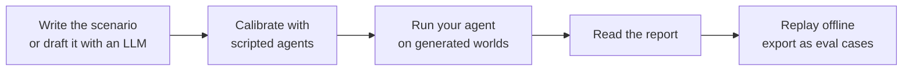

# Agent pack (MCP)

`isitright agents` checks whether an agent that passes a task still behaves well when the world it
works in changes in a small, valid way. You **declare** a service as a [scenario](write-a-scenario.md). The core generates
valid worlds, serves each to your agent over MCP, records every call and the final state, judges
each run, and writes a report you can replay offline.

## What you provide

| Piece | What it is | Effort |
|---|---|---|
| **Scenario** | Python file: [entity schema](../concepts/worlds-and-mutations.md#the-entity-model), tools with simulated handlers, base state, task, [hints](../concepts/hints.md), [oracle](../concepts/oracles-and-roles.md) | The main cost. See [Write a scenario](write-a-scenario.md) |
| **Agent command** | A command that reads an MCP config and runs your agent on the task | Small. See [Run your agent](run-your-agent.md) |
| **Budget** | Runs, seconds, money | Flags. See [Run an audit](run-an-audit.md) |

The core supplies the rest: world generation, validity, screening, sequential testing,
minimization, replay and the report.

## The shape of the work

1. **Write the scenario.** Describe the service the agent talks to: what entities exist, what the
   tools do, what the task says, what is right. Most of the effort is the oracle and the hints, and
   most of the risk too: [Onboarding with an LLM](../onboarding/agents.md) helps draft both, for
   you to review.
2. **Calibrate.** Before spending money on a real agent, run scripted stand-ins: one that follows
   the policy, one that ignores it, one that refuses everything. A scenario that cannot tell them
   apart is not ready. See [Write a scenario](write-a-scenario.md#calibrate-before-you-spend-money).
3. **Run.** Your agent runs on the baseline, then on worlds in ranked order, until a rule or budget
   stops the run.
4. **Read.** [Evidence](../concepts/evidence.md) explains the report.
5. **Replay and export.** Findings replay offline and export as new eval cases.

## What to expect

- A run starts a fresh MCP server process per agent run. Even a scripted agent takes four to
  six seconds per run; a real model agent takes whatever your agent takes.
- A real audit is tens to hundreds of runs. `--max-money` and `--max-runs` are the controls.
- A finding is evidence about *your simulated service*, unless you use a
  [third-party server](external-servers.md). [Fidelity](../concepts/validity-and-fidelity.md#execution-fidelity) is `SIMULATED` by default.

## Limits to know before you start

- There is no simulated user. Tasks where a user model drives the conversation work through your
  agent command (the tau2 example has one), but isitright does not model users or check their
  consistency.
- Handlers must be deterministic given state and arguments. That is what makes a recorded run
  replayable.
- The transport is stdio, and your agent command runs with your permissions and network. isitright
  does not sandbox the agent.
- Screening replays the baseline trace, so it is a heuristic: a changed world can change what the
  agent reads.
- Scenarios are trusted Python. The CLI refuses to import one without `--trust-code`.
