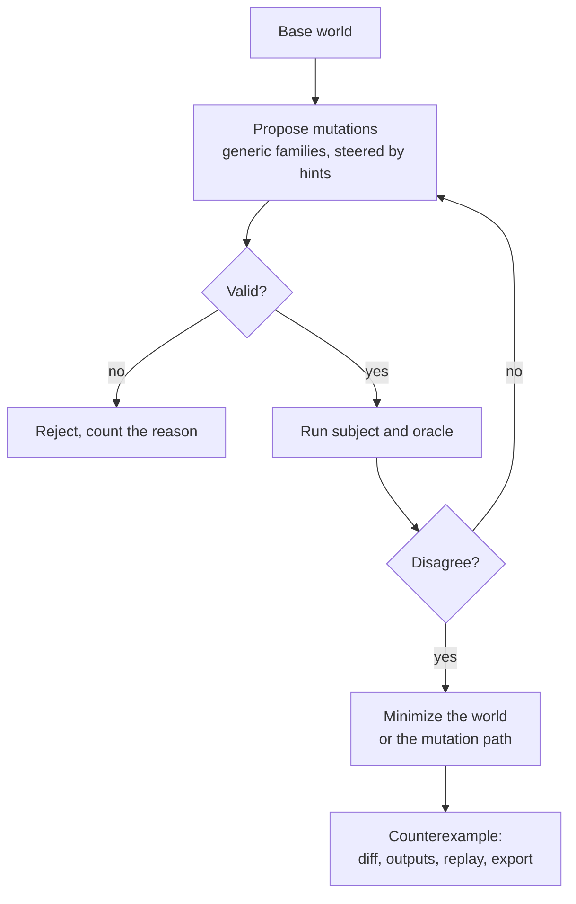

# How an audit works

An isitright audit asks one question about each passing eval case: **does the pass depend on
something about the world that could change?**

It answers by search, in four moves:

1. **Change** the world in a small, described way, keeping it valid (a duplicated customer, a NULL, an
   order exactly at the page size).
2. **Run** your agent or query, and an *[oracle](oracles-and-roles.md)*, in the changed world. The oracle is a reference that
   works out what the right answer is *there*.
3. **Compare** the two. If they agree, move on to another change. If they disagree, you have a
   *divergence*.
4. **Shrink** the divergence to the smallest world that still shows it, and report it with how far to
   trust it.

Property-based testing (QuickCheck, Hypothesis) uses the same loop for functions. isitright applies
it to your own agent and your own passing evals, where the subject can be slow, costly and random, the
worlds must stay valid, and the oracle can itself be wrong. [About](../about.md) lists related work.

## The five inputs

| Input | What it is | SQL pack | Agent pack |
|---|---|---|---|
| **World spec** | What states of the world can exist | A schema (DDL or a SQLite file) and a target engine | A scenario's [entity schema](worlds-and-mutations.md#the-entity-model), tools and service parameters |
| **Constraints** | Which states are valid | Keys, types, foreign keys, plus domain rules you write | The same, plus the service's own validity rules |
| **Task** | What the agent was asked | The question | The task text |
| **Subject** | What is under test | The candidate query | Your agent, run live |
| **Oracle** | What is right in a changed world | The reference query, re-run on each world | Invariants and a reference procedure, re-run on each world |

A fixed gold *output* is not an oracle for this purpose. It says what was right in the original
world and nothing about a changed one. The oracle has to be a program that recomputes.

## The loop

1. **Propose.** Generic *families* (a duplicated row, a NULL, a status one step off a gate) propose
   changes to the base world. [Hints](hints.md) say which fields and values matter for this task, so
   the budget goes to relevant changes first. Two mutations are composed when one is not enough.
2. **Validate.** A candidate that breaks a structural or domain rule is rejected before it runs.
   Every minimization step re-validates. See [Validity and fidelity](validity-and-fidelity.md).
3. **Run.** The host makes the world available (a database, an MCP server process) and the subject
   and oracle run in it. For a live agent this is expensive and noisy, so the loop is
   budgeted and statistical. See [Live agents](live-agents.md).
4. **Compare** under an explicit policy: multiset rows with column and float options for SQL; final
   state and call comparison for agents.
5. **Minimize.** For deterministic subjects the whole world shrinks to a few rows. For live agents
   the *mutation path* shrinks (usually one to three atoms) because the agent only sees what it
   queries.
6. **Report.** A counterexample carries the minimal world diff, both outputs, validity, [fidelity](validity-and-fidelity.md#execution-fidelity),
   the oracle used, a replay artifact and an export as an eval case.

## What the search guarantees

It is a bounded, heuristic search. The generic families are not exhaustive and the mutators are not
complete the way an SMT-based equivalence checker is within its bound. Results are therefore
asymmetric:

- A counterexample is **evidence** that can be replayed.
- [`NOT_FOUND_WITHIN_BUDGET`](evidence.md#divergence_status) says what was tried and nothing more. The report lists the budget, the
  families run and skipped, and what was rejected.

## Core and packs

The **core** knows nothing about SQL or MCP. It owns the world model, constraint language, [hints](hints.md),
mutation families, search, budgets, stochastic evaluation, minimization, replay and the report
schema. A **pack** maps its worlds into the core's entity model, supplies hosts that declare their
fidelity, and provides a comparator or oracle. You can add mutators, constraints, hints, oracles and
hosts without writing a pack; see [Write a mutator or host](../guides/extending.md).
