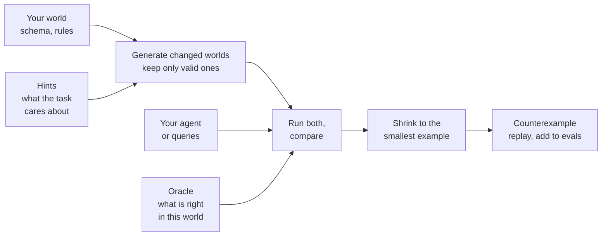

# isitright

isitright audits agent evals. Point it at your agent and the eval cases that currently pass. It
searches for small, valid changes to the world under which a pass no longer holds, and returns each
one as a [minimized](concepts/minimization-and-replay.md), replayable counterexample. You can add each counterexample back to your eval set
as a new case.

## What problem it solves

An eval case checks your agent in **one** world: one database, one set of orders, one clock. A pass
shows the agent did the right thing there. It does not show *why*. The agent may have checked the
fact that made the answer right, or it may have gotten lucky with a world where the shortcut works.

You find out which in production, when the world differs from your test data. isitright finds out
earlier. It changes the world in ways that are valid but unusual, works out what the right answer
now is, and checks whether your agent still gets it.

## Two examples

### A text-to-SQL agent

Your agent is asked: *"What is the total outstanding amount?"* Your gold query and the agent's query
both return `130` on your test database, so the case passes execution accuracy.

```sql
-- Gold: sum of the per-record shortfalls
SELECT SUM(amount_owed - amount_collected) FROM amounts;
-- Agent: difference of the two column totals
SELECT SUM(amount_owed) - SUM(amount_collected) FROM amounts;
```

isitright copies one of your rows and sets `amount_collected` to `NULL`, a state your schema allows.
It runs both queries on that database:

```text
Observed difference: reference [SUM(amount_owed - amount_collected)=70.0];
                     candidate [SUM(amount_owed) - SUM(amount_collected)=170.0].
```

The two queries only agree while no amount is missing. isitright shrinks the database to the smallest
one that still shows this, here **two rows**, and writes them out so you can read and replay them.
You decide what the question should mean when an amount is missing; isitright shows you that your
eval never asked.

### A tool-using agent

Your support agent may cancel and refund a booking only if any of the following is true: the booking was made in the last 24 hours, the
airline cancelled a flight on it, or it is a business booking. Your eval is a booking from five days
ago, in economy. The right behavior is to decline, the agent declines, and the case passes.

But an agent that declines *every* cancellation passes that case too. isitright rebuilds the world
with one small change: the booking was made 23 hours and 59 minutes ago, one minute inside the window.
Now the right answer is to cancel. It runs your agent in that world, several times, and tells you:

```text
Expected behavior not reached in 7 of 7 runs on world booked_23h_59m
Status: COUNTEREXAMPLE_FOUND. Controls: NOT_DISCRIMINATING.
```

The same machinery produces the opposite case (a booking at 24 hours and one minute, where an agent
that always cancels is wrong), changes the state of the flights, duplicates a customer, caps a page
size, or makes a tool return an empty reply. You declare what the service is and what the policy
says; isitright generates the worlds, keeps only valid ones, and judges each run against a reference.

## What you get back

For every eval case, isitright returns a report. Most important fields are:

**Did anything diverge?** isitright runs two things on each changed world: **your subject** (the
agent, or the generated query) and an **[oracle](concepts/oracles-and-roles.md)**, a reference that recomputes what is right *for that
world* (your gold query re-run on the new database; a reference procedure for an agent). A
*divergence* is a world where they disagree.

| `divergence_status` | What it means for you |
|---|---|
| [`COUNTEREXAMPLE_FOUND`](concepts/evidence.md#divergence_status) | In a valid changed world, your subject and the oracle disagree. Open the finding, read the world, decide which side is wrong |
| `NOT_FOUND_WITHIN_BUDGET` | isitright tried the worlds its budget allowed and found no disagreement. This says nothing about worlds it did not try, so it is never a claim that the agent is correct |
| `INCONCLUSIVE` | It could not decide, for example because result order was ambiguous or no agent run completed. The report says why |
| `UNSUPPORTED` | The input uses something isitright does not handle, such as an unsupported SQL feature. It is rejected, not guessed at |

Alongside the status, each finding says how much to trust it: whether the changed world obeys your
domain rules (`validity`), whether the outputs came from the real engine or an emulation
(`execution fidelity`), what the oracle was, how many of the repeated agent runs failed compared with
the unchanged world (`stability`), and the minimal world change that triggered it.

!!! warning "A divergence does not say who is wrong"
    The gold query and the reference procedure are programs somebody wrote, and they have bugs too.
    isitright reports the disagreement and leaves `attribution_status` at `UNDETERMINED`. You decide.
    [Reviewing findings](onboarding/triage.md) walks through how.

The full field-by-field explanation is in [Evidence](concepts/evidence.md).

## Where to start

| You have | Start here | What you provide |
|---|---|---|
| Text-to-SQL output: a gold query and a generated query per question | [Quick start: SQL](get-started/sql.md) | A DDL (PostgreSQL or SQLite), a SQLite file, the query pairs as JSONL, optionally domain rules |
| A tool-using agent that talks MCP | [Quick start: agents](get-started/agents.md) | A [scenario](agents/write-a-scenario.md) (service, tools, task, oracle) and a command that runs your agent |
| An eval set you want to onboard faster | [Onboarding with an LLM](onboarding/index.md) | Prompt templates that draft [hints](concepts/hints.md), constraints and scenarios for you to review |
| Unfamiliar terms | [Concepts](concepts/index.md) | Nothing. A guided vocabulary with one running example |
| A different domain | [Write a mutator or host](guides/extending.md) | Python; the extension API is experimental |

## How it works



Two packs ship today, on one shared core: one for text-to-SQL (SQLite, PostgreSQL, and DuckDB as
labeled emulation), one for tool-using agents over MCP. [How an audit works](concepts/how-it-works.md)
explains the loop in order.
