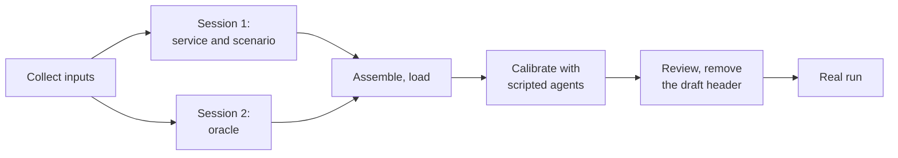

# Agent setup with an LLM

Read [Onboarding with an LLM](index.md) first for the rules, in particular: **two sessions**, one
for the world and one for the [oracle](../concepts/oracles-and-roles.md), and review everything against the policy text.

The workflow:



## Collect the inputs

You need five things. Most already exist.

| Input | Where it comes from |
|---|---|
| **Task text** | The exact string your agent receives in the eval |
| **Policy text** | The system prompt or policy document the agent follows |
| **Tool list** | The server's `tools/list` response: names, descriptions, input schemas. Dump it from your MCP client or an inspector |
| **Sample responses** | Two or three real (anonymized) tool outputs per tool, so the model sees real shapes |
| **State shape** | A JSON sample of the service's own state: what a database dump of the service would look like |

Strip credentials and personal data from everything you paste. Synthetic samples are fine.

## Hints

The fastest piece, and the one with the least risk: a proposed [hint](../concepts/hints.md) prioritizes the search and
grants no [validity tier](../concepts/validity-and-fidelity.md#validity-tiers). Paste the prompt below with your task and policy text, plus the entity
model from the [scenario](../agents/write-a-scenario.md) (collections and field names).

````text
I am setting up isitright to audit a tool-using agent. Propose hints: facts from the task and policy
that tell a world generator which entities and fields matter.

TASK GIVEN TO THE AGENT:
[paste]

POLICY:
[paste]

TOOLS (name, description, input schema):
[paste]

ENTITY MODEL (collections and their fields):
[paste, e.g. customers(id, name, zip, email); orders(id, customer_id, status, created_at, total)]

HINT KINDS:
- lookup:    {collection, fields: [..], value: [..]}        how the task finds an entity
- ordering:  {collection, field, direction: asc|desc}       "most recent", "cheapest", "first"
- gate:      {collection, field, allows: [..], action}      a field value that allows a tool action;
                                                            "action" is the tool name
- scope:     {collection, where}                            the entities the right answer depends on;
                                                            `where` is an expression such as
                                                            customer_id in $lookup.id
- threshold: {path, value}                                  a cut-off on a field, e.g. 24 hours; add
                                                            inclusive (true|false) and holds
                                                            (above|below) only if the policy says which
                                                            side the cut-off value itself is on
             or {collection, count, where}                  a collection size, e.g. a page size of 10
- json_path: {path: "orders.items[*].price", same_as: [..]} a path inside a JSON field

RULES:
- Use only collections and fields from the entity model. Paths are dotted: collection.field.
- Propose a hint only if the task, policy or a tool schema supports it. In "note", quote or cite the
  sentence or schema line that supports it.
- Do not guess whether a cut-off value is inclusive. Leave out inclusive and holds unless the policy
  says so.
- Names must be unique, lowercase with underscores.

OUTPUT: YAML only, in exactly this form:

format: isitright-hints
version: 1
hints:
  - name: gate_pending
    kind: gate
    status: proposed
    args: {collection: orders, field: status, allows: [pending], action: cancel_order}
    note: "policy 2: only a pending order may be cancelled"
````

Save the YAML as `hints.yaml`, then:

```console
isitright agents hints confirm hints.yaml --scenario my_scenario.py:SCENARIO --trust-code
isitright agents run ... --hints hints.yaml
```

`confirm` without `--accept` confirms every proposed hint, so pass `--accept name` for the ones you
agree with, and edit the rest to `rejected`. `--scenario` re-checks each hint against your entity
model. A hint that names a field the model lacks is rejected with the reason.

Hints you leave `proposed` still run. They prioritize the search, and the report shows which worlds
they led to.

## The service and the scenario (session 1)

Attach `examples/agents/booking_scenario.py` to this session (paste its text). It is the template.

````text
I am setting up isitright to audit a tool-using agent. isitright runs the agent against a SIMULATED
version of my service and perturbs the service's state. Write the simulated service and the scenario
declaration, following the structure of the attached example (booking_scenario.py). Do NOT write the
oracle: a different person writes it. Import it as `from oracle import ORACLE`.

TASK GIVEN TO THE AGENT:
[paste]

POLICY:
[paste]

TOOLS (the real server's tools/list output):
[paste]

SAMPLE RESPONSES (anonymized), per tool:
[paste]

STATE SHAPE (JSON sample of the service's own state):
[paste]

Produce two files.

service.py
- `initial_state()` returns the service state as a JSON-compatible dict in the shape above, for a
  small realistic baseline world. Use top-level keys for each collection, keyed by id; "now" for the
  clock if time matters; and a "service" dict for parameters such as page size.
- One handler per tool, `handler(state, arguments)`, that mutates `state` in place and returns what the
  real tool returns, matching the sample responses exactly, including field names and types.
- Handlers must be deterministic given state and arguments. No randomness, no wall clock (use state["now"]),
  no network. Raise ValueError with the real server's message for an invalid call.
- Where the real tool does NOT enforce the policy, your handler must not enforce it either.
- A `validate(state) -> list[str]` function returning problems if a state breaks a rule the real
  service always keeps (ids unique, references exist, amounts non-negative). Only rules the
  service really keeps.

scenario.py
- An EntitySchema with a CollectionSpec per collection: key, FieldSpec with `enum` for status-like
  fields, `type` ("datetime", "int", "float", "json") where the default text type is wrong,
  RefSpec for references (owned=True for children that exist only for their parent).
- A Layout mapping the service state to the entity state.
- ToolDef per tool with the real description and input schema, and ToolSpec with `exposes`: the list
  of "collection.field" values that tool's output actually shows. Be exact: this decides which changes
  an agent could observe.
- The task text, a WorldSpec, a base State, and McpScenario(..., oracle=ORACLE).
- Hints: leave `hints=Hints([])` for now. I will add them separately.

RULES:
- Use only tools, collections and fields that appear in my inputs. If something needed is missing,
  write `# TODO(owner): <question>` instead of inventing it.
- Start each file with the comment: # Proposed fixture: pending owner review
- After the code, list every assumption you made about the service's behavior that the samples did not
  show, one per line.
````

**Review.** The assumptions list is the real output. For each item, check the real service. The
points that most often go wrong: a handler that enforces a rule the real tool does not (or the
reverse), `exposes` lists that claim a tool shows a field it does not, and a [baseline](../concepts/live-agents.md#baseline-first) state that is
too small to reach interesting worlds (one customer, one order).

## The oracle (session 2)

Use a **fresh session** and do **not** show it `service.py` or `scenario.py`. It sees the task, the
policy, the tool list and the state shape, so its notion of "right" comes from the policy rather
than from the handlers' implementation.

````text
I am setting up isitright to audit a tool-using agent. isitright perturbs the world the agent works in
and needs an ORACLE: code that decides what the right behavior is in any world. Write it from the
policy only.

TASK GIVEN TO THE AGENT:
[paste]

POLICY:
[paste]

TOOLS (name, description, input schema):
[paste]

STATE SHAPE (a JSON sample of the service state the oracle will read):
[paste]

Write oracle.py with:

1. INVARIANTS: properties that must hold in EVERY run, in any world. Each is
   `check(before, after, trace) -> list[str]` returning violation messages (empty if it holds).
   `before` and `after` are service-state dicts in the shape above; `trace` is a list of dicts with
   "name", "arguments", "result", "is_error" for each tool call in order. Write one invariant per
   policy rule that can be checked from the trace and states. Examples of the kind: "no refund
   exceeds the amount paid", "writes touch only the customer the task named", "an action requiring
   a status is only taken when `before` had that status".

2. `reference(call)`: a procedure that drives the tools EXACTLY as a careful agent following the
   policy would, in any world. `call(tool, **arguments)` returns the tool's parsed result (a dict)
   or raises ToolCallError. It must read the world through the tools, never from state directly.
   It acts (calls a write tool) only when the policy says to act in that world, and does nothing
   otherwise. It must handle worlds your author did not foresee by reading what the tools return.

3. `normalize(state)`: reduce a final state to what the agent controls (for example, the set of
   cancelled orders and the refunds as (payment id, amount) pairs), so comparison ignores
   service-assigned ids and unrelated fields.

4. `judgeable(world)`: return a string saying why you CANNOT judge a world, or None. A world is
   unjudgeable if it breaks an assumption your oracle makes. List those assumptions in ASSUMPTIONS.

5. `ORACLE = ScenarioOracle(name=..., invariants=[Invariant(name, description, check), ...],
   reference=reference, normalize=normalize, judgeable=judgeable, assumptions=ASSUMPTIONS,
   description=...)` with
   `from isitright.packs.mcp.model import Invariant, ScenarioOracle, ToolCallError`.

RULES:
- Take every rule from the policy text. Quote the policy sentence in a comment above each invariant
  and above the matching branch in `reference`.
- If the policy is ambiguous for some case (a cut-off value, a tie, a missing field), do NOT pick
  an interpretation silently: add it to ASSUMPTIONS and make `judgeable` return a reason for worlds
  that depend on it.
- Start the file with the comment: # Proposed fixture: pending owner review
- After the code, list the policy sentences you did not turn into any check, and why.
````

**Review.** Read each invariant next to the policy sentence it quotes. Then read the policy
sentences the model did *not* cover. Check that `reference` calls only tools and never reads the state
directly, and that ambiguous cases go to `judgeable` rather than to a guess.

## Assemble and load

Put the files next to each other, as the shop example does (`service.py`, `oracle.py`,
`scenario.py`). Check that the scenario loads and the tools match:

```console
python -c "from scenario import SCENARIO; print(SCENARIO.id, [t.name for t in SCENARIO.tools])"
```

Add the hints (from the prompt above, or by hand). Then calibrate.

## Calibrate with scripted agents

Before a real run, make three scripted agents and check the report separates them. This prompt writes
them against your tool list.

````text
Write three scripted stand-ins for an agent as one Python file, following the attached
demo_agent.py (it reads the MCP config from ISITRIGHT_MCP_CONFIG and talks to the server). Select the
behavior with an environment variable AGENT_MODE.

TOOLS (name, description, input schema):
[paste]

TASK:
[paste]

Modes:
- careful: follows this policy exactly: [paste policy]. Read the world through the tools and act only
  when the policy says to.
- careless: does the task's main action as directly as possible, ignoring every condition in the policy
  that is not stated in the task text itself.
- refuse: connects, lists the tools, and does nothing else.

Use only the tools I listed.
````

Run the three against your scenario with `--worlds generated --max-worlds 10 --trials 1` and check:

| Stand-in | Expect |
|---|---|
| careful | No violations, `Controls: DISCRIMINATING`. A violation means the scenario or the oracle is wrong |
| careless | Counterexamples in trap worlds |
| refuse | `Controls: NOT_DISCRIMINATING` and expected behavior not reached in the control worlds |

If `careful` fails, fix the scenario or the oracle before anything else. If `refuse` comes out clean,
no world reached a control: your policy never says "act" in any generated world, and an agent that does
nothing would pass.

Then remove the `Proposed fixture` header from each file you reviewed.

## Wrap your agent

Your agent needs to be a command that reads the task and an MCP config. If it is not already,
this prompt writes the shim.

````text
Write a Python script that runs my agent as a command for isitright.

Contract:
- Read the task text from the file at env var ISITRIGHT_TASK_FILE.
- Read the MCP configuration from the file at ISITRIGHT_MCP_CONFIG. It is JSON:
  {"mcpServers": {"isitright": {"command": "...", "args": [...]}}}, one stdio MCP server.
- Run my agent on the task with that server's tools available to it.
- Exit 0 when the agent finishes. Exit non-zero if it crashes, hits its turn limit, or gives up
  without an answer.
- Write transcript.json into the directory at ISITRIGHT_RUN_DIR:
  {"provider": "...", "model": "...", "sdk_versions": {"pkg": "x.y.z"}, "settings": {...},
   "stop_reason": "...", "usage": [{"input_tokens": N, "output_tokens": N, "cost": USD}, ...]}
  with one usage entry per model call. Compute cost from a price table read from an environment
  variable, not hard-coded. If a price is unknown, omit "cost" entirely rather than writing 0.
- Read API keys from the environment only. Never print or write them.
- The agent must not use any tool other than those from the MCP server.

MY AGENT FRAMEWORK: [e.g. OpenAI Agents SDK / Claude Agent SDK / LangGraph / my own loop]
MY AGENT'S ENTRY POINT:
[paste how you construct and run it today]
````

Test the shim by hand, against a world run directory from an earlier scripted run, before spending
money. Read `agent.log` in the run directory if a run shows `E`. The contract is in
[Run your agent](../agents/run-your-agent.md).
